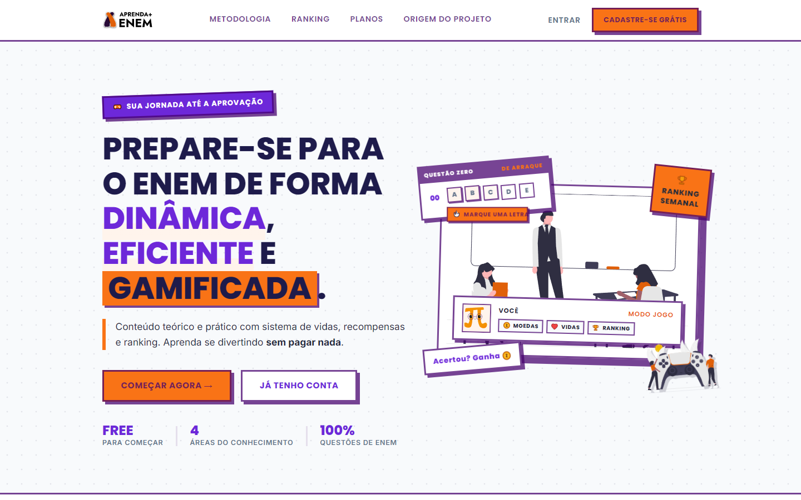

# Aprenda+ ENEM 🎮

> Plataforma gamificada de preparação para o ENEM projetada com design neo-brutalista, cartelas de treino interativas, sistema de recompensas em moedas e ranking semanal dinâmico.

🔗 **[Acesse a Demonstração Online](https://vaporubdev.github.io/aprenda-mais-enem/)**



---

## 📌 Sobre o Projeto

O **Aprenda+ ENEM** é uma landing page imersiva e de alto impacto visual desenvolvida para apresentar uma plataforma educacional inovadora. O objetivo central é transformar a rotina intensa de estudos para o vestibular em uma jornada dinâmica e motivadora, integrando **metodologias ativas** e **elementos de videogame** (moedas, vidas, pódio e carimbos de conquista).

O projeto foi construído inteiramente com tecnologias web nativas (**HTML5, CSS3 e JavaScript Puro**), priorizando performance instantânea, micro-interações fluidas e responsividade completa.

---

## 🎨 Design & Identidade Visual

A interface segue os princípios do **Neo-brutalismo**, tendência estética que une atitude e alta legibilidade:

- **Bordas Retas & Contornos Marcados:** Estrutura sólida com bordas espessas (`3px solid`) e sombras duras deslocadas sem desfoque (`box-shadow: 8px 8px 0 var(--ink)`).
- **Paleta de Alto Contraste:** Roxo Vibrante (`#6D28D9`), Laranja Intenso (`#F97316`) e nuances neutras para equilibrar legibilidade e energia gamer.
- **Tipografia Expressiva:** Harmonização entre a robusta **Poppins** (para títulos de grande escala) e a limpa **Inter** (para textos corridos e cartelas).
- **Acessibilidade:** Suporte à diretiva nativa `@media (prefers-reduced-motion)` para respeitar as preferências de acessibilidade dos usuários.

---

## 🚀 Funcionalidades & Gamificação

- 📝 **Cartelas de Resposta Interativas (Answer Sheet):** Simulação funcional do cartão de respostas do ENEM no hero e na seção de ranking. O usuário pode marcar as bolinhas (uma por linha), recebendo feedback tátil, moedas flutuantes e o carimbo de conclusão animado.
- 🪙 **Sistema de Moedas Flutuantes (`coin-fly`):** Motor de partículas em JavaScript puro que calcula a trajetória, rotação 3D e elevação das moedas de recompensa a cada ação concluída.
- 🏆 **Pódio & Ranking Semanal:** Exibição gamificada dos melhores colocados da semana e linha interativa *"Desafiar o top 3"*, permitindo ao usuário interagir diretamente com a tabela.
- 🎯 **Missões nos Cards de Metodologia:** Micro-missões clicáveis nos diferenciais com feedback de *"✓ MISSÃO ACEITA"*, soltando burst de moedas.
- 💳 **Comparativo de Planos:** Apresentação clara das vantagens do plano Gratuito vs. Premium com badges destacados e botões de chamada para ação (CTA).

---

## 🛠️ Tecnologias Utilizadas

- **Estrutura & Semântica:** HTML5 Semântico
- **Estilização & Design System:** Vanilla CSS3 (Custom Properties, Flexbox, CSS Grid, Keyframe Animations)
- **Lógica & Micro-interações:** JavaScript Puro (ES6+ sem dependências ou frameworks)
- **Gráficos & Ilustrações:** Vetores em SVG otimizados e ícones temáticos

---

## 📂 Estrutura do Repositório

```text
├── img/           # Ícones vetoriais (.svg) e ilustrações da interface
├── index.html     # Estrutura semântica e acessível da landing page
├── style.css      # Sistema de design neo-brutalista e responsividade
├── script.js      # Mecânicas de gamificação, cartelas e moedas
├── preview.png    # Imagem de preview para documentação
├── .gitignore     # Arquivos e diretórios ignorados pelo Git
└── README.md      # Documentação completa do projeto
```

---

## 💻 Como Executar Localmente

Por ter sido construído com código nativo e sem etapas pesadas de build, rodar o projeto é extremamente simples:

1. **Clone o repositório:**
   ```bash
   git clone https://github.com/VaporubDev/aprenda-mais-enem.git
   ```

2. **Acesse a pasta:**
   ```bash
   cd aprenda-mais-enem
   ```

3. **Execute no navegador:**
   - Dê um duplo clique no arquivo `index.html`, **ou**
   - No VS Code, utilize a extensão **Live Server** clicando com botão direito em `index.html` > *Open with Live Server*.

---

## 📬 Contato & Conexões

- **GitHub:** [@VaporubDev](https://github.com/VaporubDev)
- **LinkedIn:** [erica-paixao-gois](https://www.linkedin.com/in/erica-paixao-gois/)
- **Instagram:** [@ericaa_dev](https://www.instagram.com/ericaa_dev)
- **Email:** [vaporubdev@gmail.com](mailto:vaporubdev@gmail.com)

---

Desenvolvido com carinho e código limpo por **Érica Paixão**. © 2026
